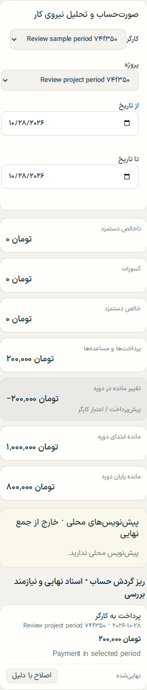

# M2 worker statement review samples

These screenshots use temporary synthetic records created by the authenticated browser verifier. The verifier deletes the sample workers, projects, records, and test accounts when it finishes.

## LAB01 reconciliation

One finalized earning of 3,000,000 toman, a 200,000 toman deduction, a 500,000 toman advance, and a 1,000,000 toman payment produce 2,800,000 toman net earnings, 1,500,000 toman paid, and a 1,300,000 toman closing balance. The statement shows the 0 opening balance and 1,300,000 closing balance.

## Date-filtered opening balance

The worker has a finalized 1,000,000 toman earning dated 2026-10-27. The statement is filtered to 2026-10-28, when a 200,000 toman payment was made. It shows 1,000,000 toman opening balance, −200,000 toman period movement, and 800,000 toman closing balance.

## View or regenerate locally

- Open this file in the repository, or open either PNG in `docs/m2/screenshots/`.
- From the repository root, run `pnpm.cmd verify:browser` in PowerShell to regenerate the screenshots under `output/playwright/m2/`. This starts the built local app and runs the full authenticated browser suite; stop `pnpm.cmd dev` first and make sure local PostgreSQL and the `.env` setup are ready as described in `README.md`.
- The examples use the browser's 360 px mobile viewport. No persistent worker or ledger data is created.
